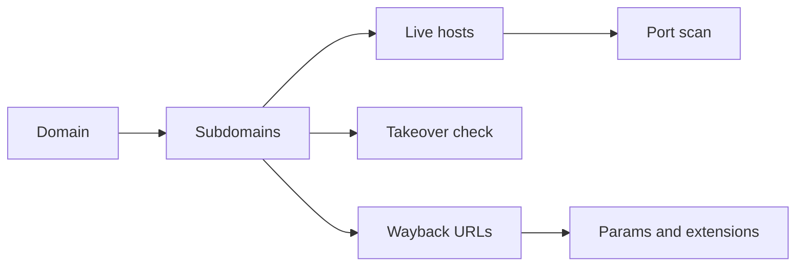

# recon-tool
<div align="center">

# 🔍 Recon Tool

**Automated reconnaissance in a single command**

Subdomains → Live hosts → Takeovers → Ports → Wayback data


</div>

---

## ✨ Features

| | Feature | Tool |
|---|---|---|
| 🌐 | Subdomain enumeration | `assetfinder` |
| 💚 | Live host detection | `httprobe` |
| 🎯 | Subdomain takeover check | `subjack` |
| 🔌 | Open port scanning | `nmap` |
| 🕰️ | Wayback URL collection | `waybackurls` |
| 🧩 | Parameter & file extension extraction | `grep` / `sort` |
| 📦 | **Auto-installs missing tools** (skips if already installed) | `apt` / `go` |

---

## 🔄 How it works



---

## 🚀 Quick Start

### 1. Clone the repository

```bash
git clone https://github.com/zakariaebnemahmud/recon-tool.git
cd recon-tool
```

### 2. Make the script executable

```bash
sed -i 's/\r$//' recon.sh
chmod +x recon.sh
```

### 3. Run it

```bash
./recon.sh example.com
```

On the first run the script installs any missing tools (`sudo` password required).
Next runs skip installation and start scanning right away.

---

## 💻 Requirements

- Linux (Kali, Ubuntu, Debian) or **WSL** on Windows
- Internet connection
- `sudo` access (first run only)

Everything else (`nmap`, `go`, `git`, `assetfinder`, `httprobe`, `waybackurls`, `subjack`) is installed automatically.

---

## 📂 Output structure

```text
example.com/
└── recon/
    ├── final.txt                  # all subdomains
    ├── httprobe/
    │   └── alive.txt              # live hosts
    ├── potential_takeovers/
    │   └── potential_takeovers.txt
    ├── scans/
    │   └── scanned.*              # nmap results
    └── wayback/
        ├── wayback_output.txt     # all archived URLs
        ├── params/
        │   └── wayback_params.txt
        └── extensions/
            ├── js.txt
            ├── php.txt
            ├── json.txt
            └── ...
```

---

## 🛠️ Troubleshooting

| Problem | Solution |
|---|---|
| `bad interpreter` error | Run `sed -i 's/\r$//' recon.sh` |
| `command not found` after install | Run `source ~/.bashrc` or reopen the terminal |
| `requires go >= ...` error | Your Go version is old, install the latest from [go.dev/dl](https://go.dev/dl/) |
| `Permission denied` | Run `chmod +x recon.sh` (use the WSL home folder, not `/mnt/d`) |

---

## ⚠️ Disclaimer

> This tool is for **educational purposes and authorized security testing only**.
> Only scan domains you own or have **written permission** to test (for example, bug bounty programs within scope).
> The author is not responsible for any misuse.

---

## 🙏 Credits

Built on top of these great open-source tools:
[assetfinder](https://github.com/tomnomnom/assetfinder) ·
[httprobe](https://github.com/tomnomnom/httprobe) ·
[waybackurls](https://github.com/tomnomnom/waybackurls) ·
[subjack](https://github.com/haccer/subjack) ·
[nmap](https://nmap.org)

<div align="center">

Made with ❤️ by [zakariaebnemahmud](https://github.com/zakariaebnemahmud)

⭐ If you find this useful, give it a star!

</div>
